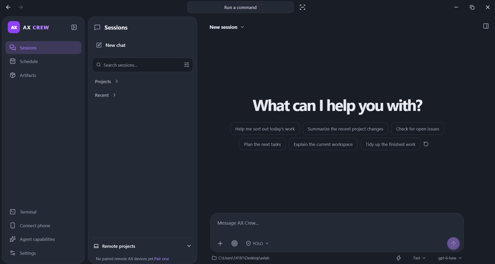

# AX Crew

A desktop workspace and Rust control plane for [AX](https://github.com/Axium-Labs/AX).
Chat with local agents, connect other machines and coordinate durable work from
one place. An Android client provides task and approval controls over your LAN.

**English** | [简体中文](README.zh-CN.md)

[Download](https://github.com/Axium-Labs/AXCrew/releases/latest) ·
[Getting started](docs/getting-started.md) · [Documentation](docs/README.md) ·
[AtomGit / GitCode](https://gitcode.com/axlab/AXCrew)

## What you can do

- **Chat and review work** — continue AX conversations, send guidance, answer
  questions, approve tools, inspect subagents and review file changes.
  [Desktop guide](docs/desktop/README.md).
- **Work locally or remotely** — choose local projects, paired AX machines or
  SSH workspaces, with project terminals and explicit execution boundaries.
  [Connections and projects](docs/desktop/README.md#connections-and-named-projects).
- **Coordinate multiple AX instances** — place dependent tasks, inspect attempts
  and artifacts, and recover eligible work from durable checkpoints.
  [Distributed collaboration](docs/distributed-collaboration.md).
- **Configure your runtime** — manage models, permissions, Mods, MCP, skills,
  delegation, optional Goal policies and local automatic learning.
  [Settings](docs/desktop/README.md#settings-pages).
- **Use the desktop workspace** — browse embedded web pages, edit local files,
  customize themes and receive completion reminders.
  [Web preview and change review](docs/desktop/README.md#web-preview-and-compact-change-review).
- **Connect from other surfaces** — use Android task controls or supported chat
  platforms; schedule recurring work through automations.
  [Android](docs/architecture/android-migration.md) · [Chat channels](docs/chat-channels.md).

## Quick start

1. Install [AX](https://github.com/Axium-Labs/AX) on the computer that will run
   your local agent.
2. Download AX Crew from [Releases](https://github.com/Axium-Labs/AXCrew/releases/latest).
   Choose a published asset for your platform; see [platform support](docs/platforms.md)
   for dependencies and validation limits.
3. Open AX Crew, configure a model provider, select a model and project folder,
   and send your first message.

For machine pairing, SSH execution, Android access and chat-platform setup,
follow [Getting started](docs/getting-started.md).

## How AX and Crew fit together

AX owns model execution, tools, permissions, credentials, memory and session
history. Crew provides the desktop/Android surfaces, device connections,
scheduling and durable coordination. Paired AX runs on its host; SSH projects
use local AX and local inference with remote shell execution.

Distributed recovery is **at-least-once**, from the last durable Workflow State
checkpoint. It does not transfer a complete model conversation or guarantee that
external side effects run only once. The control plane is a single authoritative
SQLite-backed process and needs reliable storage and backups.
[Runtime ownership](docs/architecture/design.md) ·
[Recovery and storage](docs/distributed-collaboration.md#durable-state).

## Documentation and development

Start with the [documentation index](docs/README.md). Detailed behavior lives in
topic documents rather than release-by-release additions to this README:

- [Desktop behavior](docs/desktop/README.md)
- [Distributed collaboration](docs/distributed-collaboration.md)
- [Architecture and repository layout](docs/architecture/README.md)
- [API, authentication and pairing](docs/protocol/api.md)
- [Build, test and packaging](docs/development/README.md)
- [Platform support](docs/platforms.md) · [Release notes](docs/releases/)

For the Rust control plane, run `cargo build` from the repository root. Desktop
and Android have their own prerequisites and build steps in the development guide.

## Acknowledgments

- [AtomGit / GitCode](https://gitcode.com/axlab/AXCrew): Thank you for providing
  code hosting and supporting access to AX Crew for users in China.

## License

AX Crew is licensed under [Apache-2.0](LICENSE-APACHE).
