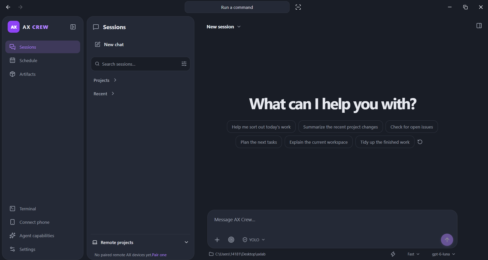
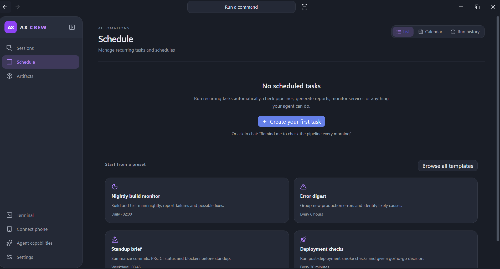
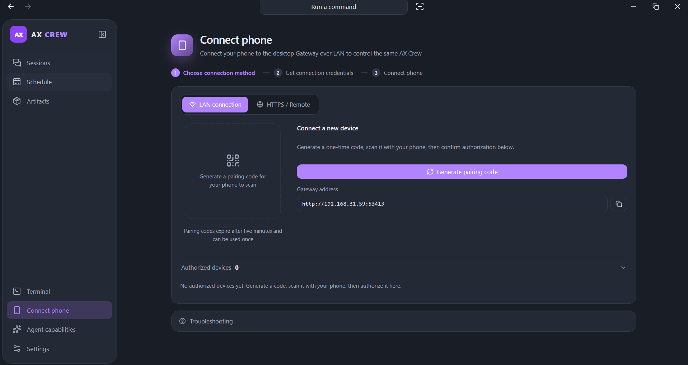

# AX Crew

When adding a desktop project, leaving its name blank uses the selected folder
name. An explicitly entered project name takes priority.

Desktop progress messages, guidance and tool groups stay in chronological order
after Stop. Thought details are collapsed individually; interrupted progress is
not promoted to a final answer, and unfinished tool rows show Stopped.

Stopping a chat keeps its accepted message and received output visible during
history reloads. Matching AX builds bound automatic file snapshots so large
workspaces can continue chatting when a complete change preview is unavailable.

Chat displays model connection and reconnection counts (up to five requests with
a matching AX), then shows a specific model connection error if it cannot recover.
The final error and count remain available after reopening the conversation.

A Rust control plane that orchestrates and controls AX agents across multiple
machines — and keeps their work running when a machine goes away.

The shared desktop client has Windows, Linux and macOS build/packaging adapters.
See [platform support](docs/platforms.md) for prerequisites, native shell settings,
updates and capability limits. New platform installers require native validation
and a release containing those assets before download.

[](crates/server/Cargo.toml)
[](https://www.rust-lang.org)
[](https://github.com/Axium-Labs/AXCrew/releases/latest)

**English** | [简体中文](README.zh-CN.md)

[AX](https://github.com/Axium-Labs/AX) is a fast, native terminal agent that
runs on any machine. AX Crew is the control plane on top of it: it connects
the AX instances on your machines, orchestrates work across them, and keeps
that work durable — task state and checkpoints live in Crew, so when an AX
drops out mid-task, another AX can pick the task up and continue. You control
every instance from one surface. The two are developed and released together —
the agent runtime and the control plane that orchestrates it.

- **Multi-machine orchestration** — Crew places tasks on AX instances across
  your machines by capability and Host resources, starts dependent tasks when
  their inputs complete, and streams events and artifacts back. AX instances
  never connect to each other; Crew coordinates all of them.
- **Durable, recoverable work** — tasks, attempts, Workflow State checkpoints,
  events and artifacts persist in Crew. When an AX goes offline, its lease
  expires and the task is placed again on an eligible AX, continuing from the
  last checkpoint. Leases and generations fence stale results.
- **One control surface** — sessions, guidance, approvals, pause, resume,
  cancel and reassignment for every AX from a single desktop app; core task and
  approval controls are also available from the Android client.
- **Local-first** — agents stay on your hardware; each machine keeps its own
  credentials, sessions and memory. There is no agent cloud.

Desktop app highlights:

- **Interactive chat questions** — ordinary main and side chats show compact
  floating AX questions above the composer, with choices and optional text replies. Answering resumes the
  same task/session; pending questions survive reopening and failed answers
  retain their drafts.
- **Native Computer Use** — the local AX desktop tool has Windows UIA, Linux
  AT-SPI and macOS Accessibility adapters. Unix requires installed runtime
  dependencies; macOS requires system privacy grants. Linux Wayland currently
  supports accessibility reads/actions with limits on raw input and screenshots.
  See [platform requirements and validation status](docs/platforms.md).
- **Settings → Goals** — configure AX-owned global/project acceptance validators,
  conservative progress observations and cumulative Runtime caps. An opt-in
  switch applies them automatically to ordinary new tasks; advanced forms start
  collapsed and retain drafts when folded. Durable execution and takeover retain Crew's existing leases/checkpoints.
- **Codex account sign-in** — choose browser authorization or device-code login
  in desktop model settings; the full one-time code is visible and copyable.
- **Settings → Plugins** — manage Mods, MCP and skills in settings. The page
  keeps workspace paths and scope explanations out of the plugin list, and
  explains when the installed AX needs updating to support Mods.
  Responsive lists keep scope/status visible, support keyboard tabs and plugin
  details, and refresh inherited configuration after changes.
  The Agents tab controls global/project delegation depth (0 off, 1 direct
  children, 2+ nested children) and shared parallelism (1–64). Save applies
  on the next turn; reset restores defaults or inheritance. Both scopes use
  the current AX `settings --scope` / `--reset` interface.
  Other settings show complete readable absolute paths in rounded icon labels.
- **Local system metrics** — desktop System settings show real Windows CPU,
  memory, system-volume usage and uptime, plus supported NVIDIA GPU usage/VRAM,
  with explicit unavailable readings.
- **Adaptive workspace** — one layout budget protects chat width, collapses
  navigation and Sessions before moving Files to a drawer, and supports a saved
  resizable chat/preview split with reset.
- **Settings switches** — boolean options and import selections use right-aligned
  pill switches with titles and descriptions on the left.
  Application and website permission choices use the same themed dropdowns as
  the other settings pages.
- **Desktop close behavior** — closing hides to the tray by default; disabling
  that setting makes closing quit Crew and stop the local service. The preference
  survives restart, and the tray Quit action always exits. System settings
  contain only the close-behavior switch.
- **Completion reminders** — when the desktop is unfocused, completed/failed
  tasks trigger a short Windows chime, a system notification and taskbar/tray
  icon attention. Unread result dots appear in Recent, project sessions and the
  Sessions navigation; reading that conversation clears its dot. Other unread
  conversations remain marked, including after restarting Crew.
- **Compact conversation controls** — a model/effort card with Fast, a stepped
  reasoning slider; click the central card for the model
  menu. Session IDs live in the Details sidebar, leaving transcripts clean.
  The composer leaves bottom space and shows project/location setup only before
  starting a new conversation. The compact model card follows the app theme,
  with lightly damped effort dragging, gentle attraction near steps, and small
  a forward-dash particle wake behind the thumb when Fast is enabled;
  remote conversations stay accessible in Recent without a separate Remote projects section.
- **Conversation files** — a wide Review/files pane with saved diffs, an
  expandable local workspace tree, closable tabs and Markdown preview/source.
  Local UTF-8 files can be edited and saved with a disk-change check. Drafts
  stay available across tabs and conversation navigation during this app run.
  Files stay open when switching to side chat or details.
- **Continue local AX conversations** — opening local history shows the original
  messages and composer together. Sending resumes the same AX session in its
  original workspace. Placeholder titles use the first user request.
- **Automation** — recurring jobs such as nightly builds, error digests,
  standup briefs and deployment checks, scheduled from presets or plain chat.

## Screenshot / Topology



Every machine runs its own AX; Crew orchestrates them from one control plane:

```text
   AX · machine 1   AX · machine 2   AX · machine 3   AX · machine N
         │                │                │                │
         └────────────────┴────────────────┴────────────────┘
                              ▼  outbound only
                 ┌──────────────────────────┐
                 │  AX Crew control plane   │
                 │  pairing · placement ·   │
                 │  leases · task DAGs ·    │
                 │  checkpoints · events    │
                 └────────────┬─────────────┘
                              │  REST / WebSocket
                 ┌────────────▼─────────────┐
                 │   Desktop client         │
                 │   (+ Android client)     │
                 └──────────────────────────┘
```

Every AX connects outbound — paired devices over authenticated WSS,
distributed workers over HTTPS — so no AX needs an inbound port, and AX
instances never connect to each other. The desktop and Android clients talk
to Crew over REST/WebSocket.

## What is AX Crew

AX Crew is a Rust control plane for AX. It runs alongside AX — on the same
machine or on one that manages the others — and turns separate AX runtimes
into one fleet.

- **AX is the agent.** It owns the agent loop, session history, memory, tools,
  skills, MCP, models, permissions and credentials on its own machine.
- **Crew is the control plane.** It connects machines (pairing, identity,
  routing), controls them (sessions, permissions, terminal) and orchestrates
  them (task DAGs, automations, retries, cancellation).
- **Clean boundary.** Crew never interprets model output or replicates AX's
  Session/Memory stores or provider credentials. Distributed collaboration
  retains selected results, checkpoints and explicitly published artifacts.

## Why

Running AX on one machine is easy. Once AX runs on several machines, you need
one place to orchestrate them and keep their work alive — that is AX Crew.

- **Orchestrate many AX as one.** Define a collaboration's tasks and
  dependencies — or let an AX delegate subtasks — and Crew places each task on
  an eligible AX, starts dependents when their inputs complete, and streams
  events and artifacts back to one place.
- **Keep work running.** A machine going offline doesn't end the job: its
  lease expires, the task returns to the queue, and another eligible AX
  continues it from the last checkpoint.
- **Durable by default.** Task state, attempts, checkpoints, events and
  artifacts survive AX disconnects and Crew restarts; no Coordinator Agent has
  to stay alive for the work to continue.
- **Automate the routine.** Nightly builds, error digests, standup briefs and
  deployment checks run on schedule and report to one place.
- **Keep control in your hands.** Approve tool access from the desktop or the
  phone; every machine keeps its own credentials.
- **No agent cloud.** Your agents never run on someone else's infrastructure
  just to be coordinated.

Recovery is at-least-once and resumes durable work from checkpoints, not a
model's complete session. Crew itself is one authoritative process backed by
SQLite; keep its database on durable storage. See
[distributed collaboration](docs/distributed-collaboration.md) for the exact
guarantees.

## How it works

1. **Run AX on each machine.** Install AX wherever you want agents; models,
   credentials, skills and memory stay local to each machine.
2. **Pair the machine.** Generate a one-time code in Crew, then on the machine
   run `ax crew pair <code> --gateway <url>` once and `ax crew connect <url>`.
3. **Build a Crew.** Add machines as members, each with its working directory,
   model and permission profile (`ask` / `allow` / `deny`).
4. **Create tasks.** A task is a prompt assigned to a member. Declare
   dependencies to form a DAG; Crew starts each task when its predecessors
   finish, honoring per-member concurrency limits.
5. **Watch it run.** Crew streams live events — agent messages, tool calls,
   permission requests — to the desktop.
6. **Intervene when needed.** Approve or reject tool access, cancel tasks,
   retry failures. If a machine disconnects, its work returns to `ready` and
   resumes the same AX session on reconnect.
7. **Automate the repeatable.** Schedule recurring tasks from presets or plain
   chat.



## Quick Start

### Install and run

1. Install [AX](https://github.com/Axium-Labs/AX) on the machines you want to
   control.
2. Install AX Crew — download the Windows installer from
   [GitHub Releases](https://github.com/Axium-Labs/AXCrew/releases/latest).
3. Open AX Crew, sign in to a model provider, pick a model and a workspace,
   and send your first message.

The desktop composer has a joined project/location strip: click the folder to
choose a project, or the local-computer pill to open the work-location menu.
The local option keeps the selected directory. Choosing Cloud reveals a Choose
environment menu for paired AX or SSH projects. Paired AX runs on its host;
SSH runs local AX and local models, using SSH only for remote shell commands. Existing sessions keep their directory, host and model fixed.
Add project opens a named-project dialog with local/remote source selection.

The desktop terminal follows the current project: local projects open the configured
local shell, and SSH projects open an interactive OpenSSH session in the remote
project directory using the saved host, port and identity file. Switching projects
selects or creates the matching terminal while keeping existing terminals attached
to their original hosts. Tabs show only the directory name, with the full initial
path on hover. Local and SSH terminals use the shell prompt's normal location
display without an extra location row. Paired AX devices
currently need a separate SSH connection for interactive terminals.

### Add another machine

Generate a one-time pairing code on the gateway, then on the second machine:

```powershell
ax crew pair <code> --gateway https://crew.example.com
ax crew connect https://crew.example.com
```



`ax crew connect` reconnects automatically. Full API and pairing details:
[docs/protocol/api.md](docs/protocol/api.md).

## Security

- **Loopback by default.** The gateway binds to loopback; any non-loopback
  bind requires `AX_CREW_ADMIN_TOKEN`, and all REST/WebSocket routes require
  `Authorization: Bearer <token>` when it is set.
- **TLS in transit.** Remote machines connect over HTTPS/WSS, typically through
  your own reverse proxy; WSS certificate verification is mandatory.
- **One-time pairing.** Pairing codes expire after five minutes and can be used
  once.
- **Signed device identity.** Devices authenticate with an Ed25519 challenge;
  private keys never enter Crew's database.
- **Human approval.** Tool access follows each member's permission profile and
  can be granted once, for the session, or rejected; unanswered requests
  expire.
- **Credential isolation.** Crew never sees provider API keys or OAuth tokens —
  they stay in each machine's AX installation.

## AX vs AX Crew

| | AX | AX Crew |
|---|---|---|
| Role | Agent runtime | Control plane |
| Scope | One machine | Many machines |
| Owns | Agent loop, sessions, memory, tools, skills, MCP, models, permissions, credentials | Device identity, pairing, task DAGs, scheduling, events, automations |
| Talks to | Models and tools | AX runtimes (ACP) and clients (REST/WebSocket) |
| Gives you | An agent on one machine | One surface for a fleet of agents |

AX does the thinking; Crew does the coordination. Run them on the same box or
apart — AX needs no cloud, and Crew adds no agent of its own. See the
[AX README](https://github.com/Axium-Labs/AX) for the runtime side of the pair.

## Architecture

AX Crew is one product made of three deliverables that only meet at stable
interfaces:

- `crates/server` — the control plane: REST/WebSocket API, DAG scheduling,
  storage, transports. The only Cargo workspace member.
- `apps/desktop` — a Tauri 2 + React desktop client with an integrated
  terminal, schedule and artifact views.
- `apps/android` — a native Android control client.

The control plane layers strictly: `api/` → `orchestration/` → `storage/` →
`domain/`, with `transport/`, `gateway/` and `ax/` as the communication and
AX-adapter boundaries. Desktop and Android reach the control plane through the
API only.

The root only organises the product; it holds no code of its own. See
[docs/architecture/README.md](docs/architecture/README.md) for the full
repository layout and module responsibilities, and
[docs/architecture/design.md](docs/architecture/design.md) for the Crew/AX
boundary, schema and state machines.

## Docs

Start with [docs/README.md](docs/README.md), the documentation map:

| Document | Topic |
|---|---|
| [docs/architecture/README.md](docs/architecture/README.md) | System architecture, layering, repository layout |
| [docs/protocol/api.md](docs/protocol/api.md) | REST/WebSocket API, authentication, pairing |
| [docs/architecture/storage.md](docs/architecture/storage.md) | Database and durability boundary |
| [docs/development/README.md](docs/development/README.md) | Build, test and packaging |
| [docs/desktop/README.md](docs/desktop/README.md) | Desktop settings and scoped plugins |
| [docs/releases/0.3.0.md](docs/releases/0.3.0.md) | Release snapshots |

## Development

Requires Rust 1.92+. The root is a Cargo workspace whose only member is
`crates/server`:

```powershell
cargo build
cargo test --workspace
```

See [docs/development/README.md](docs/development/README.md) for the full
build flow — desktop, Android, packaging — and the process-level tests.

## License

MIT. See [crates/server/Cargo.toml](crates/server/Cargo.toml).

## Distributed Collaboration

Distributed collaboration is how AX Crew orchestrates AX across multiple
machines and keeps that work running. Each machine runs one or more enrolled
AX workers (`ax crew worker worker.json`); Crew owns task placement, leases,
retries, cancellation and Workflow State checkpoints. When a worker stops
renewing its lease, Crew places the task on another eligible AX, which
continues from the last checkpoint. Ordinary single-machine AX and the
existing paired-device control keep working without it.

The **Distributed** sidebar opens a unified collaboration workspace with three views: Workspace, Nodes and Activity. Expandable distributed sections use the shared app-style Disclosure, preserving drafts when collapsed. All distributed dropdowns reuse the shared settings-style Select with themed popups and keyboard navigation. A compact status overview shows online AX, running work, failed Tasks/offline AX and queued Tasks. Stable objective/task/member/feed regions keep the workspace usable even before the first collaboration; node rows expose capacity, work/Session associations and capabilities, while Activity provides counted secondary navigation and resettable filters. Organize existing Tasks/Workflows as ordinary collaborations or explicit AX Goals; add AX participants and roles, choose placement, inspect dependencies and live ACP Sessions, and pause/resume/cancel/reassign work. Instance names and their disclosure buttons both expand details, including offline nodes. Nodes support confirmed instance deletion with busy/reference checks, credential revocation and retained execution history. Nodes follow Host → AX Instance; shared capacity and approved execution slots govern concurrency across Goals. Goal-scoped policies stay separate from AX-wide configuration. Batch operations preview differences and retain partial failures; optional native remote settings/plugins require host opt-in and confirmed write scope. Long Project is off by default and stays inline within a Goal, retaining AX-owned document/history, Session rotation and cumulative budget checkpoints. See [architecture, API and setup](docs/distributed-collaboration.md).


Creation and add-work dialogs have a fixed three-step navigation and action
footer with scrolling content. Selected AX cards expand duty/model settings
below their identity and status, numbered task cards organize assignments and
dependencies, and confirmation summarizes work and placement. Larger member
pools support AX/Host search; both themes and narrow/short windows are supported.

Distributed collaboration now creates actual multi-AX work through a three-step
plan form and one atomic Task/Workflow transaction. Native worker model catalogs
feed searchable execution selections; each Attempt freezes its Provider/Model
and duty. Matching previews share scheduler predicates and pending Tasks display
reasons. Member removal fences only its Workflow; new-member work can save in the
same policy transaction. Latest-Session routing and read-only Session history
retain rotation and migration associations. Resource minimums reserve scheduler
capacity; system resource limits are explicitly unsupported. See
[distributed contracts](docs/distributed-collaboration.md).


### Collaboration editing

The distributed workspace fills the available width and places actions in their
own views: one Connect AX entry in Nodes, creation in Workspace, refresh by the
tabs. Edit collaboration saves its name, descriptive objective and members in
responsive cards; adding members can optionally include new work. Task details
support renaming, editing input before the first execution and confirmed removal.
Started inputs remain historical; send Session guidance or add replacement work.
Dependency checks protect removal, execution history is retained in Activity, and
failed/stale saves preserve drafts. See [distributed collaboration](docs/distributed-collaboration.md)
for persistence, fencing and editing limits.


Distributed lifecycle controls include confirmed removal of empty Hosts and entire
collaborations, including cancelled/empty ones. Removing a collaboration stops its
unfinished task graph atomically while retaining execution history in Activity;
external dependencies block removal. Cancel keeps the collaboration visible.
Administrators can add new work to a cancelled retained collaboration. Task removal
is directly available in task details, with links to dependency blockers. Polling
preserves the selected collaboration and metadata drafts across runtime-only
updates. See [distributed lifecycle contract](docs/distributed-collaboration.md).

The collaboration member picker excludes deleted AX instances, including old
membership references and instances removed during editing. Saving clears obsolete
member/model/new-work references; execution history remains separately accessible.

Desktop Settings → Display offers 28 additional color themes alongside AXCrew, with independent dark/light/system mode, color samples and persistent selection. See [desktop display themes](docs/desktop/README.md#display-color-themes).

会话列表与右侧面板展开/收起时提供滑动与淡入淡出过渡，并遵循系统减少动画设置。展开时使用面板内的收起入口，关闭后使用聊天栏的展开入口，避免重复按钮；收起后的面板不参与键盘焦点。

Android 客户端允许正常截图和录屏。手机扫码连接使用局域网；账号授权、接口权限限制和撤销仍然生效。

设置 → 聊天平台提供 Slack、Discord、Telegram、Webex、企业微信、飞书、Microsoft Teams、个人微信、iMessage 和 WhatsApp 的私聊文字接入。Teams 需公网 HTTPS 回调；iMessage 需运行于 Mac；WhatsApp 需 Node.js 连接组件与扫码关联设备。其余平台使用出站连接，无需 AXCrew 共用中转。账号绑定需电脑确认，支持独立会话、任务状态、取消和单次工具审批。左侧选择平台，右侧仅显示该平台的配置；切换平台保留本页未保存的输入和扫码进度。配置与限制见 [聊天渠道](docs/chat-channels.md)。


### Web preview and compact change review

The desktop conversation sidebar has a resizable Preview tab with an HTTP(S)
address field and reload. Local dev-server URLs found in the current conversation
are offered as buttons and load only after a click. Interactive embedded pages can
receive their dev server's live updates. URLs with credentials, privileged schemes
and the application origin are rejected. Pages may prohibit embedding; remote
projects need a reachable URL or an already forwarded port. Switching conversations
clears the preview. The panel does not start servers or forward ports automatically.

Ask AX to inspect inserts the preview URL into the composer for the user to send.
AX uses its existing separate browser tool; embedded page cookies, clicks and DOM
are not shared with it. Existing browser tool restrictions still apply.

File change summaries use compact rows, aligned counts, truncated paths with full
path tooltips, and the existing sidebar diff viewer. Unavailable undo is omitted.
Allowed Computer Use applications no longer trigger generic per-action prompts;
explicit task Ask/Deny and capability Deny still apply. Website rules are unchanged.
