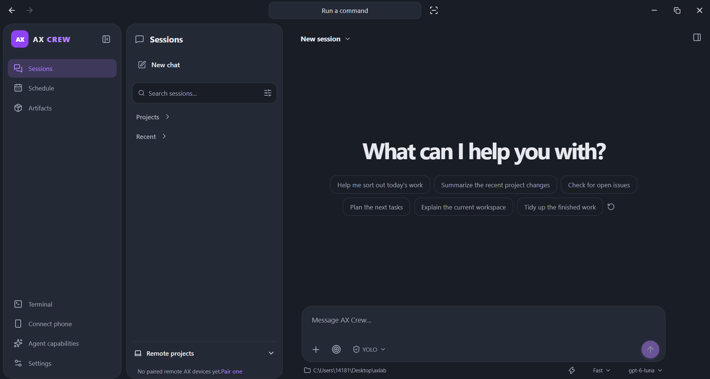

# AX Crew

为 [AX](https://github.com/Axium-Labs/AX) 提供桌面工作区与 Rust 控制平面。
在同一个界面中与本地 Agent 对话、连接其他机器、编排持久任务；
Android 客户端支持通过局域网查看任务并处理审批。

[English](README.zh-CN.md) | **简体中文**

[下载安装](https://github.com/Axium-Labs/AXCrew/releases/latest) ·
[快速开始](docs/getting-started.zh-CN.md) · [文档目录](docs/README.zh-CN.md) ·
[AtomGit / GitCode](https://gitcode.com/axlab/AXCrew)

## 主要功能

- **对话与审查**：继续 AX 会话、发送执行指导、回答问题、审批工具、查看子代理与文件变更。
  详见[桌面使用说明](docs/desktop/README.zh-CN.md)。
- **本地与远程工作**：选择本地项目、配对 AX 或 SSH 工作区，使用项目终端，并明确任务在哪里执行。
  详见[连接与项目](docs/desktop/README.zh-CN.md#connections-and-named-projects)。
- **多 AX 协作**：按依赖编排任务，查看执行尝试与产物，从持久检查点恢复符合条件的工作。
  详见[分布式协作](docs/distributed-collaboration.zh-CN.md)。
- **运行时配置**：管理模型、权限、Mods、MCP、技能和委派，按需启用 Goal 策略与本地自动学习。
  详见[设置说明](docs/desktop/README.zh-CN.md#settings-pages)。
- **桌面工作区**：使用内嵌网页预览、编辑本地文件、切换主题并接收完成提醒。
  详见[网页预览与变更审查](docs/desktop/README.zh-CN.md#web-preview-and-compact-change-review)。
- **其他入口与自动化**：通过 Android 或支持的聊天平台操作任务，用自动化安排周期性工作。
  详见 [Android 客户端](docs/architecture/android-migration.zh-CN.md)与[聊天渠道](docs/chat-channels.zh-CN.md)。

## 快速开始

1. 在运行本地 Agent 的电脑上安装 [AX](https://github.com/Axium-Labs/AX)。
2. 从 [Releases](https://github.com/Axium-Labs/AXCrew/releases/latest) 下载已发布的对应平台安装包。
   依赖、平台支持和验证限制见[平台说明](docs/platforms.zh-CN.md)。
3. 打开 AX Crew，配置模型供应商，选择模型和项目目录，发送第一条消息。

连接其他机器、使用 SSH、连接 Android 或配置聊天平台，见[快速开始文档](docs/getting-started.zh-CN.md)。

## AX 与 Crew 的分工

AX 负责模型执行、工具、权限、凭证、记忆与会话历史；Crew 负责桌面和 Android 界面、
设备连接、任务调度与持久化协调。配对 AX 在其主机上运行；SSH 项目由本地 AX 进行推理，
通过 SSH 执行远程 Shell 命令。

分布式恢复采用 **at-least-once（至少一次）** 语义，从上次持久化的 Workflow State 检查点继续。
它不迁移完整模型会话，也不保证外部副作用只执行一次。控制平面是单个权威的 SQLite 进程，
需要可靠的持久存储与备份。详见[运行时分工](docs/architecture/design.zh-CN.md)与
[持久状态及恢复](docs/distributed-collaboration.zh-CN.md#durable-state)。

## 文档与开发

从[文档目录](docs/README.zh-CN.md)进入各主题；具体功能、操作步骤和限制放在对应文档中：

- [桌面使用说明](docs/desktop/README.zh-CN.md)
- [分布式协作](docs/distributed-collaboration.zh-CN.md)
- [架构与仓库结构](docs/architecture/README.zh-CN.md)
- [API、认证与配对](docs/protocol/api.zh-CN.md)
- [构建、测试与打包](docs/development/README.zh-CN.md)
- [平台支持](docs/platforms.zh-CN.md) · [版本说明](docs/releases/)

Rust 控制平面可在仓库根目录运行 `cargo build`。桌面端和 Android 的依赖与构建步骤见开发文档。

## 致谢

- [AtomGit / GitCode](https://gitcode.com/axlab/AXCrew)：感谢提供国内代码托管与项目访问支持。

## 许可证

AX Crew 使用 [Apache-2.0 许可证](LICENSE-APACHE)。
