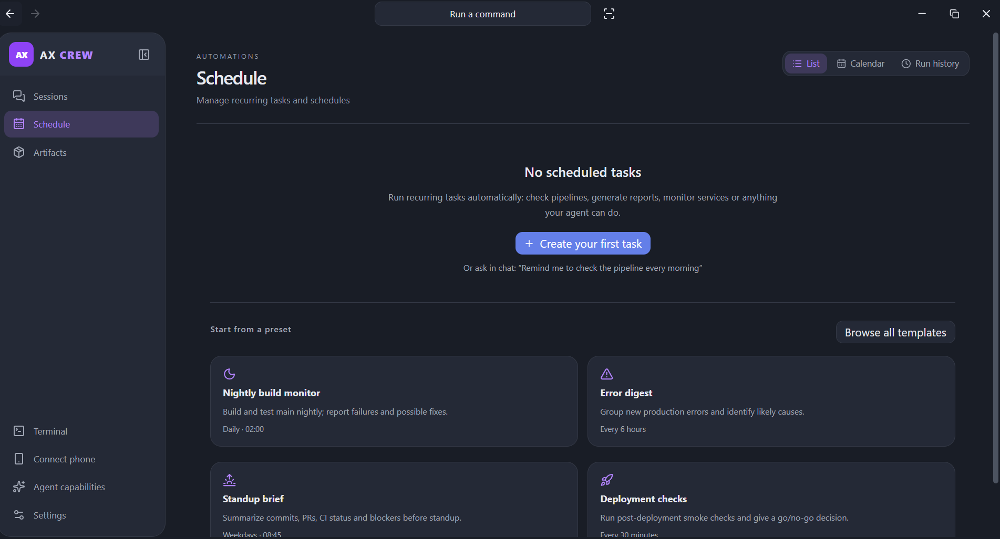
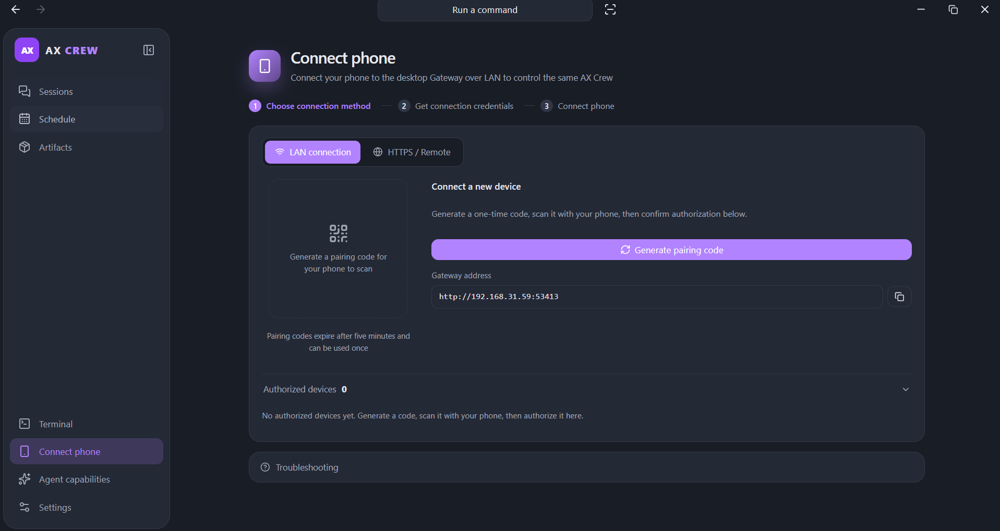

# AX Crew

桌面端添加项目时，名称留空会自动使用所选文件夹名；手动填写的项目名优先。

桌面聊天在停止后按发生顺序保留进度、补充指导和工具操作；思考内容默认单独折叠，
中断的进度不会被当成最终回答，未结束的工具显示“已停止”。

停止聊天后，已接受的消息和已收到的输出在重新加载历史时仍可见。配套的 AX 版本限制自动文件快照的范围，即使无法生成完整变更预览，大型工作区也能继续聊天。

用 Rust 编写的控制平面：编排并控制多台机器上的 AX Agent，并在机器掉线时保持工作持续运行。

会话会显示“正在连接模型”“正在重新连接模型”和实际连接次数（匹配新版 AX 时最多 5 次请求）。无法恢复时显示“模型连接失败”和原因，重新打开会话仍能看到最终失败次数。

共享桌面客户端支持 Windows、Linux 和 macOS 的构建与打包。前置条件、原生 Shell 设置、更新和能力限制见[平台支持](docs/platforms.md)；新平台安装包需要完成原生验证并发布后才能下载。

[](crates/server/Cargo.toml)
[](https://www.rust-lang.org)
[](https://github.com/Axium-Labs/AXCrew/releases/latest)

[English](README.md) | **简体中文**

[AX](https://github.com/Axium-Labs/AX) 是一个快速、原生的终端 Agent，可以在任意机器上运行。AX Crew 是它之上的控制平面：连接各台机器上的 AX 实例、跨机器编排任务，并让工作保持持久——任务状态与检查点留存在 Crew 中，当某台 AX 断开后，另一台 AX 可以接手并从上次检查点继续。你从一个统一界面控制所有实例。两者一同开发、一同发布——Agent 运行时，以及编排它的控制平面。

- **多机器编排** — Crew 按能力和主机资源把任务放到各 AX 实例上，前置任务完成后自动启动后续任务，并把事件和产物流式回传到同一个地方。AX 实例之间不直接通信，Crew 统一协调所有实例。
- **持久、可恢复的工作** — 任务、执行尝试、Workflow State 检查点、事件和产物全部持久化在 Crew 中。当某台 AX 掉线，其租约到期后任务重新放置到另一台合适的 AX，从上次检查点继续。租约和 generation 隔离机制防止过期结果写入。
- **统一控制面板** — 从单个桌面应用对每一个 AX 进行会话、引导、审批、暂停、恢复、取消和重新分配；核心的任务与审批控制也可以在 Android 客户端上完成。
- **本地优先** — Agent 留在你自己的硬件上；每台机器各自持有自己的凭证、会话与记忆。没有"Agent 云"。

桌面应用功能：

- **统一桌面界面** — 管理和设置页面使用一致的控件、对话框、标题与空状态；计划和产物列表适配紧凑窗口。
- **命令搜索** — `Ctrl/Cmd+K` 打开按最近会话、命令和页面分组的搜索面板；支持方向键选择和回车打开。
- **本地自动学习** —「设置 → 个性化」区分工具写入记忆和 AX 全局自动学习。可选择本地项目，预览建议技能及证据，接受或拒绝审核结果，并查看或归档已学习技能。导航圆点提示待审核项，运行详情默认折叠；仅使用本地 AX，并明确提示 AX 不可用或版本过旧的情况。演化数据不会发送到 Crew 服务器。
- **Codex 账号登录** — 桌面模型设置支持浏览器授权和设备码登录，完整一次性代码可查看和复制。
- **设置 → 插件** — 管理 Mods、MCP 和技能，查看范围与状态，并在需要时提示更新 AX。Agents 页签可设置全局或项目的委派深度和共享并发数；委派深度为 0 时关闭，1 为直接子代理，2 及以上允许嵌套；共享并发数范围为 1–64。模型可跨任务领域选择委派，普通子代理与队列子代理共享限制和权限上限，临时子任务的预设角色可选。保存从下一轮生效，重置恢复默认值或继承设置；两种范围使用当前 AX 的 `settings --scope` / `--reset` 接口。列表支持键盘页签、插件详情和继承配置刷新；其他设置使用带图标的圆角标签展示完整绝对路径。
- **紧凑会话控制** — 模型卡片提供 Fast 与推理强度滑块；点击模型卡片中央打开模型菜单，会话 ID 放在详情侧栏。输入框保留底部空间，仅在新会话开始前展示项目与位置设置。模型卡片跟随应用主题，推理强度拖动带轻微阻尼和档位吸附，Fast 开启时滑块后显示小幅向前粒子效果。远程会话可从最近会话访问。
- **继续本地 AX 会话** — 本地历史同时显示原消息与输入框；发送后在原工作目录恢复同一 AX 会话，默认标题采用首条用户请求。

- **聊天提问交互** — 普通主聊天及侧边聊天在输入框上方显示紧凑悬浮问题，支持编号选项、自由输入及收起；回答后续接原任务与原会话。未回答问题可在重新打开后继续处理，失败保留回答草稿。
- **原生桌面操作** — 本地 AX 提供 Windows UIA、Linux AT-SPI 和 macOS Accessibility 适配器。Unix 需安装运行依赖，macOS 需授予系统隐私权限；Linux Wayland 当前支持无障碍读取和控件动作，原始键鼠输入及截图有明确限制。[平台要求与验证状态](docs/platforms.md)。
- **设置 → Goal 目标** — 配置 AX 的全局/项目验收器、保守进展观察和累计 Runtime 预算。“开启目标”开关保存后可让普通对话的新任务自动使用 Goal，默认关闭；验收、验证器、预算与恢复设置默认收起，点击展开且保留草稿；持久化执行及接管复用 Crew 的租约与检查点。
- **会话文件** — 加宽的文件面板包含审查、工作目录文件树、多文件标签页与 Markdown 预览/源码切换；本地 UTF-8 文件支持编辑、保存、取消，保存时检查磁盘内容是否变化。草稿在本次应用运行期间跨标签页、会话保留；切到侧边聊天或详情后保留已打开文件。
- **系统指标** — 桌面端系统设置显示本机真实 CPU、内存、系统盘用量和运行时间，以及受支持 NVIDIA 显卡的使用率与显存；容量使用 GiB，读取失败明确显示不可用。
- **自适应工作区** — 统一分配多面板空间，优先保留聊天宽度，依次收起导航和 Sessions，再将 Files 切换为抽屉；聊天与文件预览可拖动调整比例并恢复默认，输入栏按自身容器宽度折叠次要操作。
- **设置开关** — 设置中的布尔选项与导入选择统一为右侧滑动开关，左侧展示标题及说明；应用和网站权限使用与其他设置相同的主题下拉框。
- **窗口关闭行为** — 默认关闭窗口后隐藏到托盘；在系统设置中关闭开关后，关闭窗口直接退出并停止本地服务。设置重启后保留，托盘菜单中的退出操作始终完全退出；设置卡片只保留关闭行为开关。
- **完成提醒** — 切换到其他软件、最小化或隐藏窗口后，任务完成/失败会播放短提示音、发送系统通知，并提示任务栏与托盘图标。其他会话的未读结果在最近会话、项目列表与导航中显示圆点；打开对应会话才清除，重启后仍保留。
- **自动化** — 夜间构建、错误摘要、站会简报、部署检查等周期性任务，从预设模板或自然语言聊天创建。

## 截图 / 拓扑


每台机器运行自己的 AX；Crew 从一个控制平面统一编排它们：

```text
   AX · machine 1   AX · machine 2   AX · machine 3   AX · machine N
         │                │                │                │
         └────────────────┴────────────────┴────────────────┘
                              ▼  outbound only
                 ┌──────────────────────────┐
                 │  AX Crew control plane   │
                 │  pairing · placement ·   │
                 │  leases · task DAGs ·    │
                 │  checkpoints · events    │
                 └────────────┬─────────────┘
                              │  REST / WebSocket
                 ┌────────────▼─────────────┐
                 │   Desktop client         │
                 │   (+ Android client)     │
                 └──────────────────────────┘
```

每个 AX 都只主动向外连接——配对设备通过经认证的 WSS，分布式 worker 通过 HTTPS——因此 AX 无需开放入站端口，AX 实例之间也从不直接连接。桌面端与 Android 客户端通过 REST/WebSocket 与 Crew 通信。

## 什么是 AX Crew

AX Crew 是为 AX 打造的一个 Rust 控制平面。它与 AX 一起运行——同一台机器，或一台管理其他机器的主机——把分散的 AX 运行时变成一支"舰队"。

- **AX 是 Agent。** 它在自己的机器上拥有 Agent 循环、会话历史、记忆、工具、技能、MCP、模型、权限与凭证。
- **Crew 是控制平面。** 它连接机器（配对、身份、路由），控制它们（会话、权限、终端），并编排它们（任务 DAG、自动化、重试、取消）。
- **边界清晰。** Crew 不解读模型输出，不复制 AX 的完整 Session / Memory 或模型凭证；分布式协作只保存所需结果、检查点与明确发布的 Artifact。

## 为什么需要它

在一台机器上运行 AX 没问题。当 AX 运行在多台机器上时，你需要一个地方来统一编排它们，并让任务在机器掉线时继续跑——这就是 AX Crew。

- **把多个 AX 当作一个整体编排。** 定义协作的任务与依赖关系（或由 AX 自行委派子任务），Crew 把每个任务放到合适的 AX 上，前置任务完成后自动启动后续任务，并把事件和产物回传到同一个地方。
- **任务不因机器掉线而中断。** 某台机器掉线后，租约到期，任务回到队列，由另一台合适的 AX 从上次检查点继续执行。
- **默认持久化。** 任务状态、执行尝试、检查点、事件和产物在 AX 断开和 Crew 重启后依然保留；工作的继续不依赖任何一个必须一直存活的协调 Agent。
- **自动化例行工作。** 夜间构建、错误摘要、站会简报、部署检查按计划运行，汇总到同一个地方。
- **掌控权在你手里。** 在桌面端或手机上审批工具访问；每台机器各自持有凭证。
- **没有 Agent 云。** 仅仅为了"被协调"，你的 Agent 也无需运行在别人的基础设施上。

恢复语义是 at-least-once：从检查点继续的是持久化的任务，而不是模型的完整会话。Crew 本身是一个以 SQLite 为后端的权威进程，请把它的数据库放在可靠的持久存储上。确切保证见[分布式协作](docs/distributed-collaboration.md)。

## 工作原理

1. **在每台机器上运行 AX。** 在你想放 Agent 的地方安装 AX；模型、凭证、技能与记忆都留在各机器本地。
2. **配对机器。** 在 Crew 中生成一次性配对码，然后在目标机器上执行 `ax crew pair <code> --gateway <url>` 一次，再执行 `ax crew connect <url>`。
3. **组建 Crew。** 把机器添加为成员，各自配置工作目录、模型与权限档位（`ask` / `allow` / `deny`）。
4. **创建任务。** 一个任务就是指派给某个成员的一条提示词。声明依赖形成 DAG；Crew 在前置任务全部完成后自动启动后续任务，并遵守每成员的并发上限。
5. **实时观察。** Crew 把实时事件——Agent 消息、工具调用、权限请求——流转到桌面端。
6. **必要时介入。** 批准或拒绝工具访问、取消任务、重试失败。若某台机器断开，其任务回到 `ready`，重连后恢复同一个 AX 会话。
7. **自动化可重复的事。** 从预设模板或自然语言聊天创建周期性任务。



## 快速开始

### 安装并运行

1. 在你想控制的机器上安装 [AX](https://github.com/Axium-Labs/AX)。
2. 安装 AX Crew——从 [GitHub Releases](https://github.com/Axium-Labs/AXCrew/releases/latest) 下载 Windows 安装包。
3. 打开 AX Crew，登录模型供应商，选择模型与工作目录，发送第一条消息。

桌面输入框的项目与位置栏连为一体：点击文件夹选择项目，点击本机标签打开工作位置菜单。本地选项保留所选目录；选择云端后可从环境菜单选择配对 AX 或 SSH 项目。添加项目会打开支持本地或远程来源的命名对话框。配对 AX 在其主机运行；SSH 使用本地 AX 和模型，通过 SSH 执行远程 Shell 命令。已有会话保留原目录、主机和模型。

桌面终端跟随当前项目：本地项目使用配置的 Shell，SSH 项目使用保存的主机、端口和身份文件打开远程交互终端。切换项目时选择或创建对应终端，已有终端仍连接原主机。标签只显示目录名，悬停显示完整初始路径；本地和 SSH 终端使用 Shell 提示符显示位置，不额外增加位置行；配对 AX 设备目前需要单独的 SSH 连接才能使用交互终端。

### 添加另一台机器

在网关上生成一次性配对码，然后在第二台机器上执行：

```powershell
ax crew pair <code> --gateway https://crew.example.com
ax crew connect https://crew.example.com
```



`ax crew connect` 会自动重连。完整 API 与配对细节见 [docs/protocol/api.md](docs/protocol/api.md)。

## 安全

- **默认只绑定回环地址。** 网关默认绑定 loopback；任何非回环绑定都要求设置 `AX_CREW_ADMIN_TOKEN`，设置后所有 REST/WebSocket 路由都要求 `Authorization: Bearer <token>`。
- **传输加密。** 远程机器通过 HTTPS/WSS 连接，通常经你自己的反向代理；WSS 证书校验是强制的。
- **一次性配对。** 配对码五分钟内有效、只能用一次。
- **签名设备身份。** 设备通过 Ed25519 挑战认证；私钥永不进入 Crew 的数据库。
- **人工审批。** 工具访问遵循各成员的权限档位，可一次性授予、按会话授予或拒绝；未应答的请求会超时。
- **凭证隔离。** Crew 永远看不到供应商 API Key 或 OAuth token——它们只留在各台机器的 AX 安装中。

## AX 与 AX Crew

| | AX | AX Crew |
|---|---|---|
| 角色 | Agent 运行时 | 控制平面 |
| 范围 | 单台机器 | 多台机器 |
| 拥有 | Agent 循环、会话、记忆、工具、技能、MCP、模型、权限、凭证 | 设备身份、配对、任务 DAG、调度、事件、自动化 |
| 通信对象 | 模型与工具 | AX 运行时（ACP）与客户端（REST/WebSocket） |
| 给你什么 | 单台机器上的一个 Agent | 一支 Agent 舰队的统一面板 |

AX 负责思考；Crew 负责协调。两者可以运行在同一台机器或分开运行——AX 不需要云，Crew 也不额外引入任何 Agent。运行时一侧见 [AX README](https://github.com/Axium-Labs/AX)。

## 架构

AX Crew 是一个产品、三个交付物，只在稳定接口处交汇：

- `crates/server` — 控制平面：REST/WebSocket API、DAG 调度、存储、传输。唯一的 Cargo workspace 成员。
- `apps/desktop` — Tauri 2 + React 桌面客户端，带集成终端、调度与产物视图。
- `apps/android` — 原生 Android 控制客户端。

控制平面严格分层：`api/` → `orchestration/` → `storage/` → `domain/`，`transport/`、`gateway/`、`ax/` 是通信与 AX 适配边界。桌面端与 Android 只通过 API 访问控制平面。

仓库根目录只组织产品，自身不含代码。完整的仓库布局与模块职责见 [docs/architecture/README.md](docs/architecture/README.md)；AX 与 Crew 的运行时职责及执行边界见 [docs/architecture/design.md](docs/architecture/design.md)。

## 文档

从 [docs/README.md](docs/README.md) 文档地图开始：

| 文档 | 主题 |
|---|---|
| [docs/architecture/README.md](docs/architecture/README.md) | 系统架构、分层、仓库布局 |
| [docs/protocol/api.md](docs/protocol/api.md) | REST/WebSocket API、认证、配对 |
| [docs/architecture/storage.md](docs/architecture/storage.md) | 数据库与持久化边界 |
| [docs/development/README.md](docs/development/README.md) | 构建、测试与打包 |
| [docs/desktop/README.md](docs/desktop/README.md) | 桌面设置与能力管理 |
| [docs/releases/0.3.0.md](docs/releases/0.3.0.md) | 版本快照 |

## 开发

需要 Rust 1.92+。仓库根是一个 Cargo workspace，唯一成员是 `crates/server`：

```powershell
cargo build
cargo test --workspace
```

完整的构建流程——桌面端、Android、打包——以及进程级测试见 [docs/development/README.md](docs/development/README.md)。

## 许可证

[Apache-2.0](LICENSE-APACHE)。见 [crates/server/Cargo.toml](crates/server/Cargo.toml)。

## 分布式协作

分布式协作是 AX Crew 跨多台机器编排 AX、并让工作持续运行的方式。每台机器运行一个或多个已注册的 AX worker（`ax crew worker worker.json`）；Crew 负责任务放置、租约、重试、取消和 Workflow State 检查点。当某个 worker 不再续租时，Crew 会把任务放到另一台合适的 AX 上，从上次检查点继续执行。普通单机 AX 和原有的配对设备控制方式不依赖它，仍可独立使用。

AX 0.3.7 / AXCrew 0.3.3 新增侧边栏「分布式协作」与 `/api/distributed` 控制层，区分 Host、AX Instance 与 Execution；一台 Host 可以运行多个 AX，一个 AX 可在获批的执行槽位内并发执行多个任务（默认一个）。AXCrew 结合 AX 能力和 Host 资源统一管理分配、租约、重试、取消与恢复。AX 通过 Durable Task、Event、Artifact、Workflow State 异步协作，AX 实例之间不直接通信，也不需要持续存活的 Coordinator Agent。在管理页注册实例、下载配置，在各机器运行 `ax crew worker worker.json`。见 [完整配置、API 与限制](docs/distributed-collaboration.md)。


协作创建采用“定义工作 → 组织 AX → 确认执行”，将多个工作任务和依赖一次性提交到既有 Workflow / 调度器。模型从目标 AX 实际回报的 Provider / Model 目录搜索选择，逐 Execution 生效；工作职责进入任务上下文，能力标签仅用于匹配。默认自动按 Host 容量和 AX 槽位调度，高级设置可选择最低资源需求及 Host / AX。匹配结果和待调度原因明确展示；移除成员仅撤销当前协作中的执行所有权，添加成员可一并安排实际任务。轮换后的交互路由到最新活动 Session，历史 Session 独立只读；节点保留迁移前后的参与记录。资源数值属于调度预留，系统强制限额仍未实现。见 [功能与接口说明](docs/distributed-collaboration.md)。


### 协作编辑与生命周期

分布式工作区提供工作区、节点和活动三个视图，可管理任务、参与者、放置、依赖与会话，并暂停、恢复、取消或重新分配工作。创建和添加工作采用三步流程，支持搜索 AX 和主机、查看匹配结果及排队原因。运行前可编辑任务输入；已启动的输入保留为历史，可继续发送会话指导或添加替代工作。删除协作或节点需要确认并检查依赖，执行历史保留在活动记录中；取消后的协作仍可添加新工作。详情见[分布式协作](docs/distributed-collaboration.md)。

桌面设置在 AXCrew 主题之外提供 28 种颜色主题，支持颜色预览、持久化选择及独立的深色、浅色或系统模式。见[显示主题](docs/desktop/README.md#display-color-themes)。侧栏遵循系统减少动画设置。子代理任务卡展示状态、实时输出、工具调用与结果，需要 AX 0.3.14 或更新版本；旧记录可能没有这些内容。Android 允许正常截图和录屏。聊天平台接入及各平台连接要求见[聊天渠道](docs/chat-channels.md)。

### 网页预览与精简变更审查

会话侧栏的预览支持 HTTP(S) 地址、搜索、前进、后退、刷新和多标签页。桌面使用原生子 WebView，开发模式使用 iframe；会话中发现的本地开发服务器地址需要用户点击才加载。预览不自动启动服务器或转发端口，远程项目需要可访问的网址或已转发端口。普通预览标签切换会话时清除，AX 控制的页面隐藏并保留。

本地 AX 可通过经过认证的本机桥接使用相同的预览页面，执行标签发现、导航、页面快照、点击、填写、输入和 Enter/Tab。控制页按 AX Session 隔离标签，每个会话最多 16 个、桌面进程最多 64 个；截图及其他按键暂不支持。首次接管已有页面会安装网络保护并重新加载，保留浏览器原有登录资料。Windows 需要支持请求过滤和 DevTools 拦截的 WebView2；其他平台目前不支持 Agent 控制内嵌页面，普通预览仍可使用。Browser Use 设置和网站 Ask/Allow/Deny 规则仍由 AX 管理，远程 AX 使用自己的运行环境。

文件变更以紧凑行显示，并通过侧栏查看 diff。已允许的电脑操作应用不会重复触发通用操作审批；明确的 Ask/Deny 规则仍生效。本地项目可以从列表移除而保留文件和会话；永久删除会话须由 AX 确认。未读完成或失败结果以圆点显示，打开对应会话后清除。


### 协作管理细节

Host 与 AX Instance 支持删除前的占用及引用检查、凭证撤销与执行历史保留。节点按 Host → AX Instance 组织；多个 Goal 共享主机容量和已批准的执行槽位。Goal 策略与 AX 全局配置分离，批量操作先预览差异并保留部分失败。原生远程设置和插件写入需主机主动启用并确认写入范围。Long Project 默认关闭，内嵌于 Goal，保留 AX 所有的文档、历史、Session 轮换及累计预算检查点。

创建与添加工作对话框使用固定的三步导航和底部操作区，内容独立滚动。选中的 AX 卡片在身份与状态下展开职责和模型设置，编号任务卡组织分配与依赖，确认页汇总工作和放置。支持 AX/Host 搜索、深浅主题及窄小窗口。

分布式工作区占满可用宽度：连接 AX 位于节点视图，创建位于工作区，刷新位于页签旁。编辑协作可保存名称、说明性目标及成员；失败或过期保存保留草稿。删除协作会原子停止未完成任务图并保留 Activity 历史，外部依赖会阻止删除；取消则保留协作。轮询不会覆盖已选协作和元数据草稿。成员选择排除已删除 AX（包括旧引用或编辑期间删除的实例），保存时清理失效成员、模型和新增工作引用，执行历史仍可访问。见[分布式协作契约](docs/distributed-collaboration.md)。

### 内嵌预览的操作与边界

预览地址栏将裸域名补为 HTTPS，将 localhost 和回环地址补为 HTTP，关键词提交后打开 Bing。起始页提供本地服务器快捷入口；浏览器开发模式为阻止嵌入的网站提供新标签链接。普通用户页面的新窗口链接创建标签，下载禁用。带凭证的网址、特权协议和应用自身来源均被拒绝，包括原生页面导航。子 WebView 按裁剪后的面板物理像素边界定位，考虑界面缩放和显示缩放，并在应用对话框或菜单下隐藏。

“让 AX 检查”将预览网址插入输入框。本地 AX 的 `browser` 工具通过每次启动认证的本机桥接操作相同页面，`list_sessions` 发现当前 AX Session 的标签，默认使用已绑定的活动标签；Agent 新建标签自动出现在预览中。标签按真实 AX Session ID 路由，而非会话标题。关闭标签或返回起始页会销毁原生视图。受控标签标注 AX 控制；“在新标签浏览”、地址导航和刷新打开独立普通预览，受控副本禁用前进和后退，弹窗必须改为显式授权的 goto。

首次接管会重新加载页面，刷新 DOM 和表单状态，沿用内嵌浏览器的 Cookie 与登录资料。Session 路由隔离标签访问，不隔离浏览器资料；已有 Cookie 和此前独立运行的用户资料 worker 不隔离。受控文档绕过缓存及 service worker 响应，禁止新建 worker。保护机制拦截跨来源资源和重定向、WebSocket、弹窗与下载，空闲受控页禁止继续后台请求；安装保护失败则操作失败。模型不能提交任意 JavaScript，远程页面没有 Tauri IPC 能力。

桥接凭据每次启动生成，不持久化，也不传入工具、MCP 或 Mod 子进程；配对或 SSH 远程 AX 不继承本机连接。桥接不可用时不会静默回退到外部浏览器。网站权限规则保持不变。

文件变更行对齐计数、截断长路径并通过提示展示完整路径，不显示不可用的撤销操作。移除项目的选项也适用于从 AX 历史自动发现的项目，移除状态在本机持久保存，重新添加文件夹即可恢复。永久删除会话使用该会话实际数据目录（包括旧版及自定义存储），AX 确认后 Crew 才删除相关任务记录。任务与会话列表成功加载后，清理不再绑定任何记录的旧通知；延迟出现的会话绑定会重新对齐，列表刷新期间的新完成事件仍保留。
