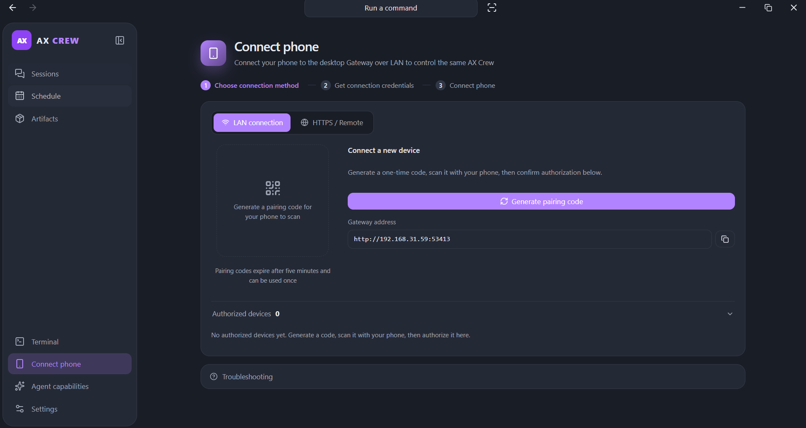
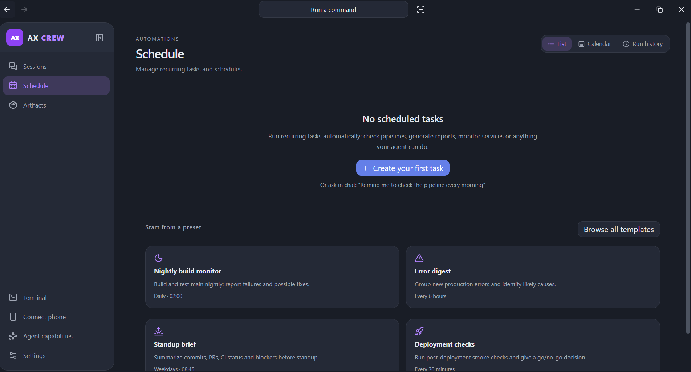

# Getting started with AX Crew

[简体中文项目介绍](../README.zh-CN.md) · [Documentation index](README.md)

Begin with a local conversation, then connect remote machines or other client
surfaces as needed. AX owns execution and model credentials; Crew coordinates work.

## Start a local conversation

1. Install [AX](https://github.com/Axium-Labs/AX) on the computer running your agent.
2. Download a published AX Crew installer from
   [Releases](https://github.com/Axium-Labs/AXCrew/releases/latest). Check
   [platform support](platforms.md) for dependencies and capability limits.
   Build adapters alone do not mean an installer has been released.
3. Open AX Crew and configure a model provider and model in desktop settings.
4. Add a project folder and send a message. A blank project name uses the folder
   name; an explicit name takes priority.

Opening local AX history shows the original conversation and composer together.
Sending continues the same AX session in its original workspace. The desktop
shows model connection progress, streamed output, questions and approvals. Stop
retains accepted messages and received output; unfinished tool rows show Stopped.
Matching AX builds bound automatic file snapshots so an unavailable full change
preview does not prevent large-workspace conversations.

Use `Ctrl/Cmd+K` to find conversations, commands and pages. See
[conversation history and execution](desktop/README.md#conversation-history-and-execution)
for recovery, guidance and file-review details, and
[questions](desktop/README.md#questions-during-ordinary-chat) for answers that
resume the same task.

## Choose where work runs

The composer project/location controls select:

- **Local projects:** AX runs on this computer in the selected directory.
- **Paired AX:** AX runs on the paired host, using that host's model configuration,
  credentials, skills and memory.
- **SSH projects:** local AX performs inference and keeps history locally;
  SSH executes shell commands on the remote host.

Existing conversations retain their original directory, host and model.
Project terminals follow local or SSH projects; existing terminal tabs stay on
their original hosts. Paired AX devices need a separate SSH connection for an
interactive terminal. See [connections](desktop/README.md#connections-and-named-projects)
and [project terminals](desktop/README.md#project-terminals).

## Pair another AX machine

Create a one-time pairing code in Crew, then on the other machine run:

```powershell
ax crew pair <code> --gateway https://crew.example.com
ax crew connect https://crew.example.com
```

Replace the example URL with your reachable gateway. The connection reconnects
automatically; pairing codes expire after five minutes and can be used once.
Devices authenticate with an Ed25519 challenge and retain private keys locally.
Read [authentication](protocol/api.md#authentication) and
[the protocol reference](protocol/README.md) before exposing a gateway.



## Coordinate tasks and recurring work

Distributed offers Workspace, Nodes and Activity views. Connect AX instances,
create a collaboration, add tasks and dependencies, and inspect placement, live
sessions and artifacts. Review approvals or send session guidance when needed.
Automations schedule recurring jobs such as builds and error digests.



Distributed workers are enrolled separately from paired-device control; follow
[distributed setup and contracts](distributed-collaboration.md) for worker
configuration, placement, editing and cancellation. Recovery uses leases and the
last durable Workflow State checkpoint, with at-least-once execution. It does
not migrate a complete model conversation or make external effects exactly-once.
Back up the authoritative Crew database.

## Customize the desktop

Detailed behavior lives in the [desktop guide](desktop/README.md):

- [Settings](desktop/README.md#settings-pages): models, permissions, optional Goal
  policies, local automatic learning, system metrics and close behavior.
- [Scoped plugins](desktop/README.md#scoped-ax-plugins): Mods, MCP, skills and
  global/project inheritance.
- [Subagent workspace](desktop/README.md#subagent-workspace): child tasks, nested
  activity and results, depending on the installed AX version.
- [Web preview and file review](desktop/README.md#web-preview-and-compact-change-review):
  native tabs, browser control limits, local editing and change inspection.
- [Themes](desktop/README.md#display-color-themes) and
  [completion reminders](desktop/README.md#completion-reminders-and-unread-results).

## Android and chat platforms

Android connects over your LAN and supports core task, session and approval
controls. Pairing, revocation and some management actions remain desktop
operations. Android permits normal screenshots and screen recording; account
permissions and revocation still apply. See [Android capabilities](architecture/android-migration.md).

Settings → Chat platforms configures Slack, Discord, Telegram, Webex, WeCom,
Feishu, Microsoft Teams, personal Weixin/WeChat, iMessage and WhatsApp. Each has
prerequisites; appearing in the list does not mean a channel is connected. Teams
needs a public HTTPS callback, iMessage needs a Mac and WhatsApp needs a Node.js
companion and linked-device sign-in. Peer authorization requires desktop approval.
See [chat channels](chat-channels.md) for setup, project/session menus and limits.

## Security and operational boundaries

The gateway defaults to loopback. A non-loopback bind requires
`AX_CREW_ADMIN_TOKEN`; configure it for reverse-proxy exposure too. Management
routes enforce bearer/phone authorization according to configuration; pair-code
redemption and device challenges have their own protections. Phone credentials
have restricted LAN scope. See [API authentication](protocol/api.md#authentication).

Remote connections use HTTPS/WSS with certificate verification. Tools still
follow AX permissions and the selected policy. Computer Use, embedded browser
control and Android have different platform limits; see [platform support](platforms.md),
[desktop settings](desktop/README.md#computer-use-and-browser-settings) and
[runtime ownership](architecture/design.md). For source builds and deployment,
follow [Development](development/README.md).
