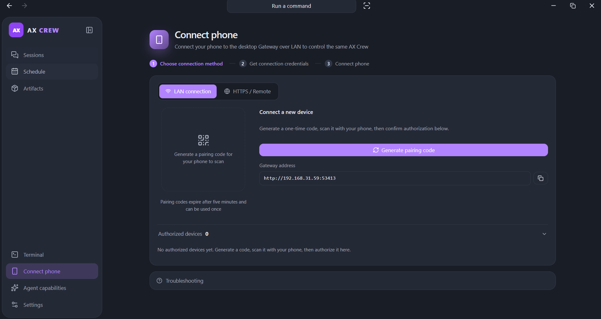
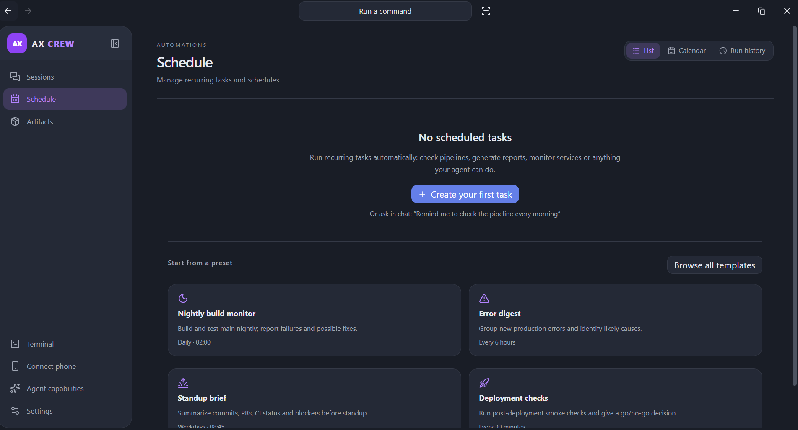

<a id="getting-started-with-ax-crew"></a>
# AX Crew 快速开始

[English](getting-started.md) | **简体中文**

[简体中文项目介绍](../README.zh-CN.md) · [文档目录](README.zh-CN.md)

先开始一次本地对话，再按需连接远程机器或其他客户端。AX 负责执行和模型凭证，Crew 负责协调工作。

<a id="start-a-local-conversation"></a>
## 开始本地对话

1. 在运行 Agent 的电脑上安装 [AX](https://github.com/Axium-Labs/AX)。
2. 从 [Releases](https://github.com/Axium-Labs/AXCrew/releases/latest) 下载已发布的 AX Crew 安装器。依赖和能力限制见[平台支持](platforms.zh-CN.md)。存在构建适配器，不代表对应安装器已经发布。
3. 打开 AX Crew，在桌面设置中配置模型供应商与模型。
4. 添加项目目录并发送消息。项目名称留空时使用目录名，手动填写的名称优先。

打开本地 AX 历史时会同时显示原对话与输入框；发送消息会在原工作区继续同一个 AX 会话。桌面显示模型连接进度、流式输出、问题和审批。停止后仍保留已接受的消息与已收到的输出，未结束的工具行显示 Stopped。配套 AX 构建限制自动文件快照的范围，因此即使完整变更预览不可用，大型工作区也能继续对话。

使用 `Ctrl/Cmd+K` 查找对话、命令和页面。恢复、指导和文件审查细节见[会话历史与执行](desktop/README.zh-CN.md#conversation-history-and-execution)；如何通过回答问题续接同一任务，见[对话中的问题](desktop/README.zh-CN.md#questions-during-ordinary-chat)。

<a id="choose-where-work-runs"></a>
## 选择执行位置

输入框的项目/位置控件可选择：

- **本地项目**：AX 在本机所选目录运行。
- **配对 AX**：AX 在配对主机上运行，使用该主机的模型配置、凭证、技能和记忆。
- **SSH 项目**：本地 AX 进行推理并在本地保存历史，通过 SSH 在远程主机执行 Shell 命令。

已有会话保留原目录、主机与模型。项目终端跟随本地或 SSH 项目；已有终端页签仍连接原主机。配对 AX 设备需要单独的 SSH 连接才能使用交互终端。详见[连接](desktop/README.zh-CN.md#connections-and-named-projects)与[项目终端](desktop/README.zh-CN.md#project-terminals)。

<a id="pair-another-ax-machine"></a>
## 配对另一台 AX 机器

在 Crew 中生成一次性配对码，再在另一台机器上执行：

```powershell
ax crew pair <code> --gateway https://crew.example.com
ax crew connect https://crew.example.com
```

将示例 URL 换成可访问的实际网关地址。连接会自动重连；配对码五分钟内有效，只能使用一次。设备通过 Ed25519 挑战进行认证，私钥保存在设备本地。对外开放网关前，请阅读[认证说明](protocol/api.zh-CN.md#authentication)和[协议参考](protocol/README.zh-CN.md)。



<a id="coordinate-tasks-and-recurring-work"></a>
## 编排任务和周期性工作

Distributed 提供 Workspace、Nodes 和 Activity 视图。连接 AX 实例、创建协作、添加任务与依赖，再查看任务放置、实时会话和产物。需要干预时处理审批或发送会话指导。自动化可定期执行构建、错误摘要等工作。



分布式工作进程的注册与配对设备控制相互独立。工作进程配置、任务放置、编辑和取消，见[分布式配置与约定](distributed-collaboration.zh-CN.md)。恢复依赖租约与最后一次持久化的 Workflow State 检查点，执行采用至少一次语义，不迁移完整模型会话，也不保证外部副作用恰好执行一次。应备份作为权威数据来源的 Crew 数据库。

<a id="customize-the-desktop"></a>
## 自定义桌面

详细行为见[桌面指南](desktop/README.zh-CN.md)：

- [设置](desktop/README.zh-CN.md#settings-pages)：模型、权限、可选 Goal 策略、本地自动学习、系统指标和关闭行为。
- [按作用域配置的插件](desktop/README.zh-CN.md#scoped-ax-plugins)：Mods、MCP、技能与全局/项目继承关系。
- [子代理工作区](desktop/README.zh-CN.md#subagent-workspace)：子任务、嵌套活动与结果，具体支持取决于所装 AX 版本。
- [网页预览与文件审查](desktop/README.zh-CN.md#web-preview-and-compact-change-review)：原生标签页、浏览器控制限制、本地编辑和变更检查。
- [主题](desktop/README.zh-CN.md#display-color-themes)与[完成提醒](desktop/README.zh-CN.md#completion-reminders-and-unread-results)。

<a id="android-and-chat-platforms"></a>
## Android 与聊天平台

Android 通过局域网连接，支持核心任务、会话与审批控制。配对、撤销和部分管理操作仍需在桌面端完成。Android 允许正常截图和录屏，账号权限与撤销仍然生效。详见 [Android 能力](architecture/android-migration.zh-CN.md)。

“设置 → 聊天平台”可配置 Slack、Discord、Telegram、Webex、企业微信（WeCom）、飞书（Feishu）、Microsoft Teams、个人微信（Weixin/WeChat）、iMessage 和 WhatsApp。每个平台都有前置条件，出现在列表中不代表已连接。Teams 需要公网 HTTPS 回调，iMessage 需要 Mac，WhatsApp 需要 Node.js 配套组件和关联设备登录。账号授权需在桌面确认。配置、项目/会话菜单及限制见[聊天渠道](chat-channels.zh-CN.md)。

<a id="security-and-operational-boundaries"></a>
## 安全与运行边界

网关默认绑定回环地址。非回环绑定必须配置 `AX_CREW_ADMIN_TOKEN`；经反向代理暴露 API 时也应配置。管理路由根据配置执行 Bearer/手机授权校验；配对码兑换与设备挑战使用各自的保护机制。手机凭证仅有受限的局域网 API 范围，详见 [API 认证](protocol/api.zh-CN.md#authentication)。

远程连接使用 HTTPS/WSS 并校验证书。工具仍遵循 AX 权限与所选策略。Computer Use、内嵌浏览器控制与 Android 的平台限制不同，详见[平台支持](platforms.zh-CN.md)、[桌面设置](desktop/README.zh-CN.md#computer-use-and-browser-settings)与[运行时分工](architecture/design.zh-CN.md)。源码构建和部署步骤见[开发文档](development/README.zh-CN.md)。
